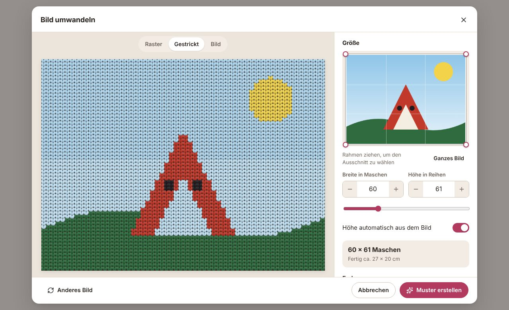
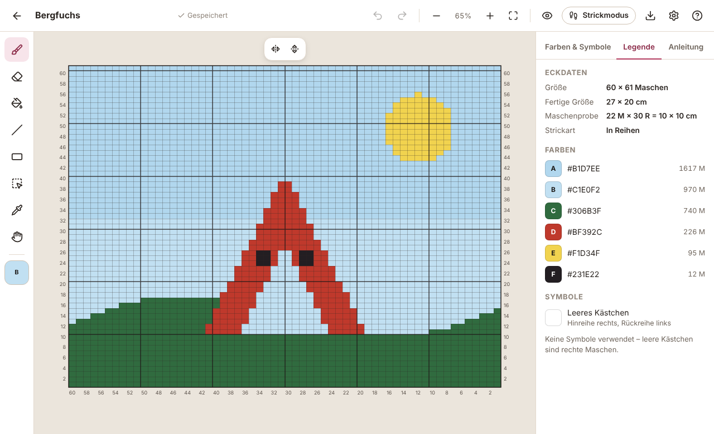
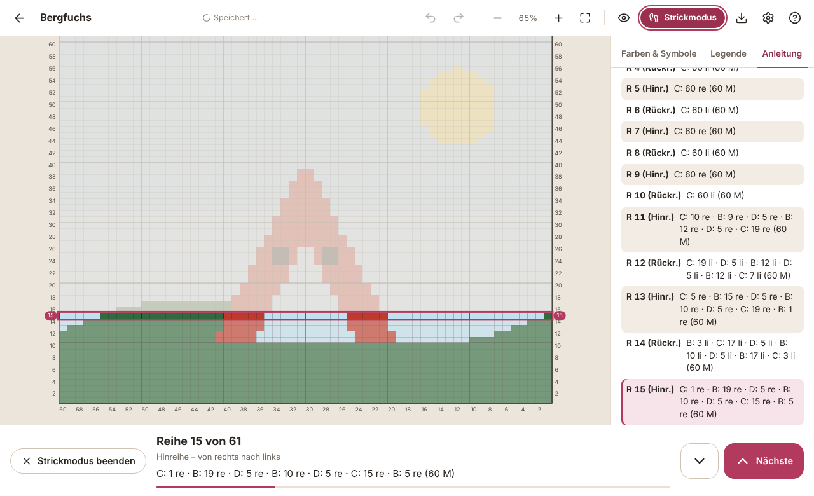
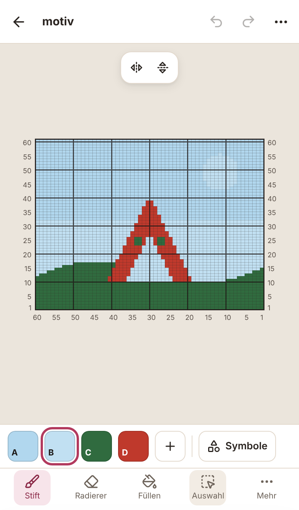

# Maschenwerk – Strickmuster-Generator

Eine Progressive Web App, mit der sich Strickmuster (Strickschriften) einfach erstellen lassen –
im Stil gängiger Chart-Editoren: Kästchenraster mit Reihen- und Maschennummern, Farben, Strickschrift-Symbolen,
Legende und schriftlicher Anleitung. Bilder lassen sich automatisch auf ein konfigurierbares Maschenraster übertragen.

**Live:** https://maschenwerk.fredie.io

Die App läuft **komplett im Browser**, braucht **kein Backend und kein Konto** und funktioniert nach dem ersten Aufruf auch **offline**.
Muster werden lokal im Browser (IndexedDB) gespeichert und können als Datei gesichert und weitergegeben werden.



## Funktionen

**Bild umwandeln**
- Foto oder Grafik auswählen, per Drag & Drop ablegen oder mit Strg+V einfügen
- Ausschnitt mit Rahmen wählen, Breite in Maschen festlegen – die Höhe in Reihen ergibt sich automatisch
  (oder frei wählbar, der Ausschnitt passt sich an)
- **Maschenprobe** berücksichtigen (quadratisch, glatt rechts oder eigene Werte), damit das Motiv nicht verzerrt wird
- Anzahl Farben wählen (2–12); Farbreduktion im wahrnehmungsgerechten OKLab-Farbraum mit Mehrheitsentscheid je Masche
  → klare Kanten ohne Mischfarben, kleine markante Details bleiben erhalten
- Farben per Tipp durch die eigenen Garnfarben ersetzen
- Feinschliff: Einzelmaschen entfernen, Dithering, Helligkeit/Kontrast/Sättigung
- Live-Vorschau als Raster, als **gestricktes Bild** oder im Vergleich zum Original
- Fertige Größe in cm wird angezeigt

**Editor**
- Raster mit Reihennummern (Hinreihen rechts, Rückreihen links, in Runden immer rechts) und Maschennummern von rechts nach links,
  dicke Hilfslinien alle 5 oder 10 Maschen
- Werkzeuge: Stift, Radierer, Füllen, Linie, Rechteck, Auswahl, Pipette, Verschieben – optional **symmetrisch** (links/rechts, oben/unten)
- Auswahl kopieren, ausschneiden, einfügen (auch zwischen Mustern), spiegeln, füllen, **über die ganze Breite/Höhe wiederholen** (Rapport), zuschneiden
- Farbpalette mit Namen (z. B. Garn + Farbnummer), Farben ersetzen/entfernen, Hauptfarbe festlegen
- Strickschrift-Symbole: rechte/linke Masche, Umschlag, Ab- und Zunahmen, verschränkte Maschen, Noppe, Abketten, keine Masche, Zöpfe 1/1, 2/2 und 3/3
- Rückgängig/Wiederholen, Zoom (Mausrad, Trackpad, Pinch-Geste), Tastenkürzel
- Ansichtsoptionen: Gestrickt-Vorschau, Rapport-Vorschau, lange Spannfäden markieren (Fair-Isle)
- Größe ändern mit Ausrichtung, ganzes Muster spiegeln, Strickart (Reihen/Runden), Maschenprobe, Notizen

**Legende & Anleitung**
- Legende mit Farben, Symbolen (Bedeutung auf Hin- und Rückreihe) und Maschenanzahl je Farbe
- Schriftliche Anleitung Reihe für Reihe – inklusive Farbwechseln, erkannten Rapporten (`[2 re, 2 li] 15×`) und Maschenzahl

**Strickmodus**
- Aktuelle Reihe hervorgehoben, noch nicht gestrickte Reihen abgedeckt, Anleitung der Reihe groß angezeigt
- Weiter/zurück per Tipp, Pfeiltasten oder Leertaste; Fortschritt wird gespeichert; Bildschirm bleibt an

**Speichern & Export**
- Automatisches Speichern im Browser, Übersicht mit Vorschaubildern, Duplizieren, Umbenennen, Löschen (mit Rückgängig)
- Musterdatei (`.json`) zum Sichern oder Weitergeben, Sicherung aller Muster in einer Datei
- Export als PNG mit Nummern und Legende (auf dem Handy auch direkt teilen)
- Drucken / PDF: Raster wird mit wählbarer Kästchengröße auf A4-Seiten verteilt, mit Legende und Anleitung
- Anleitung als Textdatei

**PWA**
- Installierbar auf Handy, Tablet und Desktop, offline nutzbar, Hinweis bei neuer Version
- Hell-/Dunkelmodus, Deutsch und Englisch, Bedienung per Maus, Touch und Stift

| Editor mit Legende | Strickmodus | Handy |
| --- | --- | --- |
|  |  |  |

## Entwicklung

Voraussetzung: Node.js 22 oder neuer.

```bash
npm install
npm run dev          # Entwicklungsserver auf http://localhost:5173
npm test             # Unit-Tests (Vitest)
npm run test:e2e     # End-to-End-Tests (Playwright; Chromium ggf. mit "npx playwright install chromium" installieren)
npm run typecheck    # TypeScript-Prüfung
npm run build        # Produktions-Build nach dist/
npm run preview      # Build lokal ansehen (inkl. Service Worker)
npm run icons        # App-Icons neu erzeugen (scripts/generate-icons.mjs)
```

### Projektstruktur

```
src/
  model/        Datenmodell: Raster, Symbole, Farben, Anleitung, Serialisierung (ohne DOM, getestet)
  image/        Bild → Raster: Farbreduktion (k-means++ in OKLab), Dithering, Glätten, Web Worker
  render/       Canvas-Zeichnen: Raster, Symbole, Nummern, Gestrickt-Vorschau, Vorschaubilder
  editor/       Editor: Zustand mit Rückgängig, Canvas-Steuerung (Werkzeuge, Gesten), Panels, Dialoge
  import/       Dialog „Bild umwandeln“ mit Zuschneiden und Vorschau
  export/       PNG, Druckansicht, Downloads
  storage/      IndexedDB-Speicher mit Fallback
  pages/        Startseite, „Neues Muster“
  i18n/         Texte (Deutsch/Englisch)
tests/          Unit-Tests
e2e/            Playwright-Tests
```

## Veröffentlichen (GitHub Pages, maschenwerk.fredie.io)

Die App ist eine rein statische Website (`dist/`). Der Workflow `.github/workflows/deploy.yml` prüft bei jedem Push auf
`main` Typen und Tests, baut die App und veröffentlicht sie auf GitHub Pages. Pull Requests werden nur gebaut und getestet.

Einmalige Einrichtung für die Domain **maschenwerk.fredie.io**:

1. *(Empfohlen, gegen Domain-Übernahme)* `fredie.io` in den GitHub-Kontoeinstellungen unter
   *Settings → Pages → Add a domain* verifizieren (TXT-Eintrag beim DNS-Anbieter).
2. Beim DNS-Anbieter von `fredie.io` einen **CNAME**-Eintrag anlegen:
   `maschenwerk` → `friewerts.github.io` (ohne Repository-Namen). Keine Wildcard-Einträge verwenden.
3. Im Repository unter *Settings → Pages*:
   - *Build and deployment → Source*: **GitHub Actions**
   - *Custom domain*: `maschenwerk.fredie.io` eintragen und speichern
   - sobald verfügbar (kann bis zu 24 h dauern) **Enforce HTTPS** aktivieren
4. Änderungen auf `main` bringen – der Workflow veröffentlicht automatisch.

Eine `CNAME`-Datei ist bei Veröffentlichung per GitHub Actions nicht nötig (sie würde ignoriert); die Domain wird
ausschließlich in den Pages-Einstellungen hinterlegt.

Soll die App ohne eigene Domain unter `https://<user>.github.io/<repo>/` laufen, im Repository die Variable
`BASE_PATH` (*Settings → Secrets and variables → Actions → Variables*) auf `/<repo>/` setzen. Lokal entsprechend:
`BASE_PATH=/<repo>/ npm run build`. Jeder andere Webspace mit HTTPS funktioniert ebenso.

## Datenschutz

Alle Bilder und Muster bleiben auf dem eigenen Gerät. Es gibt keine Server-Kommunikation außer dem Laden der App selbst.
Da Browser lokale Daten unter Umständen löschen (z. B. beim Aufräumen von Website-Daten), bittet die App um dauerhafte
Speicherung – wichtige Muster sollten trotzdem regelmäßig mit „Alle sichern“ als Datei gesichert werden.
